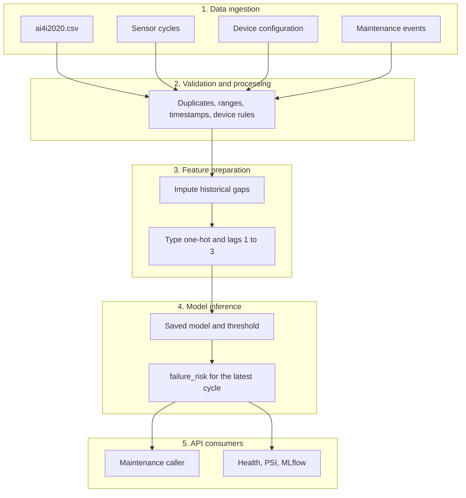

# AI4I failure-risk service

This service scores industrial milling cycles from the UCI AI4I 2020 Predictive Maintenance Dataset and returns a failure risk on `POST /predict`.

## 1. Problem

A maintenance caller sends recent sensor cycles for one device and needs a failure risk for the latest cycle, with a clear rejection when the payload is incomplete or inconsistent with that device.

Prediction use case: rank the current cycle as low, medium, or high risk so a planner can inspect the machine. The score is the model's probability of `Machine failure`. High means the probability is at or above the threshold chosen on the training validation block.

### Assumptions

- The UCI file has no clock time. `UDI` is the cycle order. A `timestamp` column, when present, overrides `UDI`. Naive timestamps are read as UTC.
- The UCI file has no machine id. `Product ID` is one cycle, and `Type` is the product quality variant L, M, or H. Batch training treats the file as device `MILL_01` unless a device id column is present.
- `TWF`, `HDF`, `PWF`, `OSF`, and `RNF` are pieces of the failure label and are not model inputs.
- Live scoring needs the current cycle and three earlier cycles so lag 1, lag 2, and lag 3 match training.
- Missing sensors are imputed only while preparing a historical file. A live request must include every sensor.
- Duplicate `UDI`, `Product ID`, or device timestamp values are removed from historical files and rejected on the API.
- Maintenance events record install, tool change, inspection, and retire. Install time and retire time constrain readings. Tool changes and inspections are operational records, not model features.

The same list is returned by `GET /features` and stored on the training quality report.

### Data-quality rules

| Check | Historical file | Live `POST /predict` |
| --- | --- | --- |
| Missing sensor | Impute after a holdout comparison of mean, median, empirical resampling, and predictive mean matching | Reject the request |
| Duplicate `UDI`, `Product ID`, or device timestamp | Keep the earliest row | Reject the request |
| Sensor outside the physical range, or process temperature below air temperature | Drop the row | Reject the request |
| `Product ID` prefix differs from `Type` | Drop the row | Reject the request |
| Type, speed, torque, or tool wear outside the device configuration | Drop the row | Reject the request |
| Timestamp before install or at/after a retire event | Drop the row | Reject the request |
| Timestamp | `UDI` order when the column is absent | ISO-8601. Out-of-order cycles are sorted and `data_quality.reordered` is true |

Physical ranges: air temperature 250–350 K, process temperature 250–400 K, rotational speed 1–10000 rpm, torque 0.01–500 Nm, tool wear 0–10000 min. The published file sits inside these ranges, has no nulls, no duplicate keys, and no prefix mismatches, so cleaning removes zero rows and the saved model stays valid.

## 2. Design

Training and live scoring share validation and feature preparation. A historical file drops bad rows and imputes gaps. A live request is rejected instead, and the caller repairs the payload.



### Data ingestion

| Input | What it supplies |
| --- | --- |
| `ai4i2020.csv` | Training cycles: sensors, `Type`, `UDI`, `Product ID`, and `Machine failure` |
| `data/sensor_readings.csv` | Twelve sample cycles. The timestamp is `2020-01-01T00:00:00Z` plus `UDI - 1` minutes, and the file includes the first failure at UDI 51. `Machine failure` is the label, not an API field |
| `data/device_configurations.csv` | Allowed product types, install time, status, and speed, torque, and tool-wear limits |
| `data/maintenance_events.csv` | Install, tool change, inspection, and retire events |
| `POST /predict` body | One device's current cycle and at least three earlier cycles |

`MILL_02` is a second configured device with a tighter speed limit, product type L only, and a retire event. It exercises inconsistent configuration while the published training rows stay valid for `MILL_01`.

### Validation and processing

`src/quality.py` applies one rule set in two modes.

| Check | Training file | Live request |
| --- | --- | --- |
| Duplicate `UDI`, `Product ID`, or device timestamp | Keep the earliest row | Reject |
| Missing sensor | Leave the gap for imputation | Reject |
| Value outside the physical range, or process temperature below air temperature | Drop the row | Reject |
| `Product ID` prefix differs from `Type` | Drop the row | Reject |
| Type or sensor limit disagrees with the device configuration | Drop the row | Reject |
| Timestamp before install, or at or after a retire event | Drop the row | Reject |
| Clock | `UDI` order when no timestamp exists | ISO-8601, naive values read as UTC. Out-of-order cycles are sorted |

A device file that disagrees with its install event is a configuration error. Training then skips device rules and records the error. The API returns HTTP 500 and does not score.

### Feature preparation

`src/preprocess.py` runs after cleaning.

1. Compare mean, median, empirical resampling, and predictive mean matching on a masked holdout. Keep the method whose filled column stays closest to the original distribution. This file has no nulls, so the columns are left unchanged and the chosen method is still recorded.
2. Build the model matrix: one-hot `Type`, the five current sensors, and those sensors at lag 1, lag 2, and lag 3.
3. Drop the first three cycles of a device. They have no full lag window.
4. Leave `TWF`, `HDF`, `PWF`, `OSF`, and `RNF` out of the matrix. They are pieces of the failure label.

Live scoring calls the same lag function. The request must already contain the four cycles, so the API does not impute.

### Model inference

`src/train.py` fits XGBoost and a scaled k-nearest neighbor on a chronological split. The first 80% of cycles train the model, a slice of that block picks the F1 threshold, and the last 20% is the test block. The saved bundle in `artifacts/model.joblib` is the model with the higher test F1. It also stores the feature names, the threshold, and the training-row distribution used later for drift.

`POST /predict` scores every cycle that has a full window and returns the latest one as `failure_risk`: probability of `Machine failure`, a 0/1 decision at the saved threshold, and a band of low, medium, or high.

### API consumers

| Consumer | How it uses the service |
| --- | --- |
| Maintenance caller | `POST /predict` with raw cycles. Reads `failure_risk` for the current cycle |
| Batch or replay caller | `POST /predict/stream`, the same contract, or `POST /predict/features` when the matrix is already built |
| Operator | `GET /health` for the loaded model and device files. `GET /features` for the contract and assumptions. `POST /model/reload` after a retrain |
| Monitoring | Each scored batch can write row count, positive rate, and mean probability to MLflow. Thirty or more rows also produce a population stability index. Optional labels add precision, recall, F1, and ROC-AUC |

| Piece | Role |
| --- | --- |
| `src/quality.py` | Duplicates, ranges, timestamps, device rules |
| `src/preprocess.py` | Imputation and lag features |
| `src/train.py` | Chronological split, model choice, saved bundle |
| `src/monitoring.py` | PSI drift and classification metrics |
| `deployment/app.py` | HTTP API |

## 3. Data processing

`prepare_training_frame` cleans, then imputes, then builds lags. Imputation runs a masked holdout and keeps the method whose filled column stays closest to the original distribution. On this file every sensor is complete, so the columns are not modified. The selected method is still recorded for a later extract that does contain gaps.

Sample files:

- `data/device_configurations.csv`
- `data/sensor_readings.csv`
- `data/maintenance_events.csv`

Timestamps on the sensor sample are `2020-01-01T00:00:00Z` plus `UDI - 1` minutes. That clock is synthetic. The UCI file itself has no timestamps.

## 4. Model

Training is chronological: the first 80% of cycles fit the model, a slice of that block picks the F1 threshold, and the last 20% is the test block. XGBoost and a scaled k-nearest neighbor are both fit. The saved bundle is the one with the higher test F1.

Features for each cycle:

- One-hot `Type` (`type_l`, `type_m`, `type_h`)
- The five current sensors
- The same five sensors at lag 1, lag 2, and lag 3

The first three cycles of a device have no full window and are not scored.

`POST /predict` returns the latest scored cycle as `failure_risk`:

| Field | Meaning |
| --- | --- |
| `failure_risk` / `probability` | Probability of machine failure |
| `machine_failure` | 1 when the probability is at or above the saved threshold |
| `risk_band` | `low` below half the threshold, `medium` below the threshold, `high` at or above it |
| `input_index` | Position in the request array |
| `threshold` | Decision threshold stored with the model |

`predictions` lists every scored cycle in time order. `failure_risk` is the last of those, which is the current cycle.

## 5. API

Start the service:

```bash
python -m uvicorn deployment.app:app --host 127.0.0.1 --port 8000
```

Score four raw cycles:

```bash
curl -X POST http://127.0.0.1:8000/predict -H "Content-Type: application/json" --data-binary @artifacts/sample_sensor_request.json
```

`POST /predict` body:

```json
{
  "device_id": "MILL_01",
  "log_to_mlflow": false,
  "records": [
    {
      "timestamp": "2020-01-02T00:00:00Z",
      "type": "M",
      "product_id": "M14860",
      "air_temperature_k": 298.1,
      "process_temperature_k": 308.6,
      "rotational_speed_rpm": 1551,
      "torque_nm": 42.8,
      "tool_wear_min": 0
    }
  ]
}
```

Dataset column names (`Type`, `Air temperature [K]`, and the others) are accepted as well. `device_id` defaults to `MILL_01`. Send at least four cycles.

| Route | Behavior |
| --- | --- |
| `POST /predict` | Raw cycles for one device. Returns `failure_risk`. |
| `POST /predict/stream` | Same contract as `POST /predict`. |
| `POST /predict/features` | Rows that already use the training feature names. See `artifacts/sample_request.json`. |
| `GET /health` | Model name, threshold, and configured devices. |
| `GET /features` | Feature names, raw fields, and assumptions. |
| `POST /model/reload` | Load a replacement `artifacts/model.joblib` without a process restart. |

Schema problems return HTTP 400 with `Invalid request` and the field path. Domain problems return HTTP 400 with `message` and `errors`. A missing model file returns HTTP 503. A broken device configuration returns HTTP 500 and does not score.

## 6. Production readiness

### Monitor

- `GET /health` reports the loaded model and whether the device files still parse.
- Each scored batch can log row count, predicted positive rate, and mean probability to the MLflow experiment `ai4i_deployment_monitoring`.
- When the batch has at least 30 rows, population stability index is computed against the training reference. Below 0.1 is stable, below 0.25 is a moderate shift, and 0.25 or above is a major shift. A major shift adds `monitoring.distribution.action` telling the caller to retrain before treating the scores as current.
- If the caller sends 0/1 labels, precision, recall, F1, and ROC-AUC are logged for that batch.
- Training already records the same PSI between the chronological train and test blocks.

Set `log_to_mlflow` to false when a caller does not want a tracking write. If the tracking store is down, the score is still returned and `monitoring.mlflow_error` explains the failure.

### Model and data changes

- Retrain with `python -m src.train`. The run compares XGBoost and KNN on the chronological test block and writes `artifacts/model.joblib` plus `artifacts/model_comparison.json`.
- The bundle stores feature names, the threshold, the training-row distribution, and the MLflow run id.
- `POST /model/reload` picks up the new file in the running process.
- A changed extract should be retrained end to end so imputation choice, lag statistics, and the drift reference are fit on the new rows. The live reference is not edited by hand.
- A major PSI shift is the signal to retrain. The API still returns the score so the caller can see the drift beside it.

### Scale

- The process is stateless. History arrives on the request, so replicas do not share session memory.
- Score one device per request. Add uvicorn workers or containers behind a load balancer as device count grows.
- The saved model is one in-memory estimator. This feature width is a CPU score.
- The local MLflow SQLite file is the part that does not scale across hosts. Point `tracking_uri` at a shared database before running more than one replica, or monitoring splits across files.

## Tests

```bash
python -m pytest
```

The tests cover cleaning of the published file, duplicates, ranges, timestamps, device limits, retire and install windows, the raw predict contract, validation errors, and the engineered-feature endpoint.
